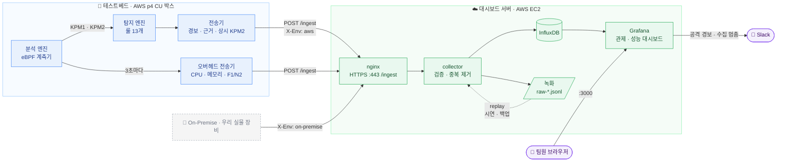

# PortRAN Observability

5G 기지국 위협 탐지 솔루션의 **수집기 · 대시보드 · 검증 파이프라인**.



- 메시지 형식: [`schema/SCHEMA.md`](schema/SCHEMA.md) ← **다른 파트 담당자는 이것만 보면 된다**
- 탐지 엔진 레코드 형식의 기준: [`reference/detection/27_탐지엔진_1-4단계-대시보드-지표_명세서.md`](reference/detection/27_탐지엔진_1-4단계-대시보드-지표_명세서.md) (탐지 엔진 담당, 11/05 확정)
- 진행 현황: [`docs/progress.md`](docs/progress.md). M1~M7(스키마, collector, 대시보드, replay, AWS 배포 — mock 생성기로 먼저 개발), M8·M9(탐지 엔진 레코드 수신·저장, AWS `/ingest` HTTPS 경로 — 탐지 쪽 전송기 연동 시험 통과) 완료. M10 대시보드 재구성(관제 대시보드·성능 대시보드 탐지 성과, mock·evaluator·처음 메시지 형식 삭제)에 이어 M11에서 수집 오버헤드를 탐지 쪽 형식(11/13)으로 받아 성능 대시보드 CU 자원 줄에 보이고, M12에서 AWS 공격 경보·수집 멈춤을 Slack으로 알린다.

## 준비물

| 항목 | 비고 |
|---|---|
| Docker + Docker Compose | Windows는 Docker Desktop 실행 + Settings → Resources → WSL integration에서 사용하는 배포판 켜기 |
| Python 3.10+ | Ubuntu/WSL에서 venv가 없으면 `sudo apt install python3-venv` |
| poppler-utils | Claude Code로 작업할 때 필요. `reference/`의 논문 PDF를 읽는 데 쓴다(`pdftoppm`). `sudo apt install poppler-utils` |

## 처음 실행하기

```bash
# 1. 접속 정보 준비 (필요하면 토큰·비밀번호를 바꾼다)
cp .env.example .env

# 2. InfluxDB + Grafana 기동
docker compose up -d
docker compose ps        # 둘 다 running, influxdb는 (healthy)

# 3. Python 환경
python3 -m venv .venv
source .venv/bin/activate
pip install -r requirements.txt

# 4. 테스트
pytest
```

접속:

| 서비스 | 주소 | 로그인 |
|---|---|---|
| Grafana | http://localhost:3000 | `.env`의 `GRAFANA_ADMIN_USER` / `GRAFANA_ADMIN_PASSWORD` |
| InfluxDB UI | http://localhost:8086 | `.env`의 `INFLUX_ADMIN_USER` / `INFLUX_ADMIN_PASSWORD` |

Grafana의 **Connections → Data sources → InfluxDB**가 자동으로 등록되어 있어야 한다. 들어가서 **Save & test**를 누르면 bucket 연결 성공 메시지가 나온다.

## 자주 쓰는 명령

```bash
docker compose logs -f grafana     # provisioning 오류 확인
docker compose down                # 중지 (데이터 유지)
docker compose down -v             # 중지 + 데이터 전부 삭제
```

> **`.env`의 InfluxDB 값(토큰, org, bucket, 계정)은 최초 기동 때만 적용된다.**
> 나중에 바꾸면 Grafana는 새 토큰으로 접속을 시도하지만 InfluxDB에는 옛 토큰이 남아 있어 인증이 실패한다.
> 바꾼 뒤에는 `docker compose down -v && docker compose up -d`로 초기화한다(저장된 데이터가 지워진다).

## collector 실행하기

메시지를 받아 스키마로 검증하고, InfluxDB에 쓰고, 받은 그대로 녹화한다.

```bash
# 탐지 엔진 전송기·replay 받기 (POST /ingest, 서버 안에서만 열고 TLS는 앞단이 맡는다). Ctrl+C로 종료 — 남은 배치를 쓰고 끝냄
python -m collector.collector --in http://127.0.0.1:8088

# 탐지 쪽 샘플 파일을 환경 이름을 붙여 한 번에 넣기
python -m collector.collector --in file://tests/data/detection/T10_긴공격_evidence.jsonl --once --env sample

# 여러 입력을 동시에 (UDP는 시험용)
python -m collector.collector --in udp://127.0.0.1:9999 --in http://127.0.0.1:8088

# InfluxDB 없이 검증·녹화만 (다른 파트에서 메시지 형식을 확인할 때)
python -m collector.collector --dry-run --in http://127.0.0.1:8088
```

| 옵션 | 설명 |
|---|---|
| `--in` | `http://host:port`(탐지 엔진 전송기·replay `POST /ingest`), `udp://host:port`, `file://path`. 여러 번 줄 수 있음. 기본은 `.env`의 `COLLECTOR_UDP_HOST:PORT` |
| `--once` | 파일 입력을 끝까지 읽고 종료 (없으면 `tail -f`처럼 계속 기다림) |
| `--env` | UDP·파일로 받은 탐지 엔진 레코드의 환경 이름 (HTTP는 `X-Env` 헤더, 기본 `unknown`) |
| `--from-end` | 파일의 기존 내용은 건너뛰고 새로 추가되는 줄만 읽음 (기본은 처음부터) |
| `--dry-run` | InfluxDB에 쓰지 않음 |
| `--recordings` | 녹화 폴더 (기본 `.env`의 `RECORDINGS_DIR`) |

결과물 (`recordings/`, git 제외):
- `raw-<날짜시각>-<환경>.jsonl`: 모든 레코드(`overhead` 포함)를 환경(`X-Env`·`--env`)별로 받은 그대로. 다시 보낸 줄(중복)은 한 번만 남는다. replay 입력으로 쓴다
- `rejected.jsonl`: 거부된 메시지와 사유 (`received_at`, `source`, `reasons`, `raw`). 실행할 때마다 이어 붙는다

1초마다 `수신 / 저장 / 거부 / 중복` 건수가 로그로 나온다. `/ingest`는 InfluxDB에 쓴 뒤 응답하고, InfluxDB가 잠시 죽으면 `503`을 돌려줘 전송기가 다시 보내게 한다. UDP·파일 입력은 메모리에 들고 있다가(최대 `COLLECTOR_MAX_PENDING`건) 복구되면 쓴다.

`/ingest` 응답 코드·중복 키·직접 보내 보는 법(`curl`)은 [`schema/SCHEMA.md`](schema/SCHEMA.md) 2절에 있다. 요청 상한·대기 시간·중복 키 수는 `.env`의 `COLLECTOR_HTTP_*`·`COLLECTOR_DEDUP_MAX_KEYS`.

> **collector가 준비된 뒤에 보낸다.** 시작해서 입력을 열기까지 몇 초(WSL의 `/mnt/c`에서는 4~5초) 걸린다. 로그에 `녹화 …`가 나온 뒤에 보낸다.

## 대시보드 보기

`docker compose up -d`만 하면 Grafana의 **PortRAN** 폴더에 대시보드가 올라온다(provisioning). collector를 띄우고 replay로 샘플을 넣으면 바로 채워진다(아래 "개발·시연 데이터").

**관제** — http://localhost:3000/d/portran-monitoring (새로고침 5초, 기본 최근 1시간)

| 행 | 패널 |
|---|---|
| 탐지 결과 | 고른 시간 범위에 시작한 경보: 공격별 경보 수(막대), 경보 길이 분포, 공격별 경보 결과 표 |
| KPM (상시 KPM2) | 셀별 3초 RRC 연결 시도·성공·무응답 막대, UE 컨텍스트·연결 UE 수(셀 한도 96). 긴 시간 범위(예: 7일)는 3초 배수 구간으로 묶는다 — 막대는 구간 합, UE 수는 구간 최대(평균 선은 평균). 주황 영역 = 경보 구간(영역 어디에 마우스를 대도 툴팁에 경보 — 종류·공격 이름·셀·상태·심각도), 회색 = 데이터 없음·칸 일부 없음(3초 칸이 그 세션 보고 주기로 다 차지 않음 — 100 ms면 30줄, 1,000 ms면 3줄), 파란 세로선 = 분석 엔진 세션 시작, 보라 세로선 = DU·CU 재시작 |
| 경보 목록 | 경보 하나 = 한 행(시작·셀·공격 이름·종류·심각도·UE 수·대표 값·상태·길이). 대표 값 `ratio`는 %(0.5714 → 57%). **행을 누르면 경보 상세가 그 경보로 바뀐다** |
| 경보 상세 | 판정 요약, 판정 근거 값(키는 줄임말 없는 이름 — `grafana/evidence-key-names.json`), 후보 공격, 걸린 UE(UE는 `셀-uid`, 예 `6733824-63`), 근거 KPM(100 ms 근거 KPM2, 셀 지표 경보), UE_EVENT — UE별 메시지 흐름·메시지 흐름 상세(근거 KPM1 `ue_evt`, UE 메시지 경보) |

- 위쪽 변수: **데이터 출처**(AWS = 실측 `aws` / On-Premise = 우리 실물 장비 `on-premise` / AWS (이전 p4) = 11/20 전 AWS 실측 / 재생 = replay / 샘플 = 탐지 쪽 샘플), 셀. 경보 상세에 보일 경보는 경보 목록에서 행을 눌러 고른다(위쪽 칸 없음, 처음 열면 가장 최근 경보).
- 그래프 위 표시(경보 구간, 데이터 없음, 칸 일부 없음, 세션 시작, DU·CU 재시작)는 늘 켜져 있다(끄는 토글 없음). 경보 구간은 주석이 아니라 그래프 계열로 칠해 새로고침 때 깜빡이지 않는다.
- 경보 목록의 상태 '상태 불명' = 열린 경보에 마지막 레코드 뒤 1단계 15초·2~4단계 90초 동안 아무것도 없음(탐지 엔진이 죽었거나 다시 떴을 수 있음).
- 맨 위 '요약 — 지금' 줄(열린 경보·최고 심각도·수집 상태·세션)은 없애고, 성능 대시보드에 있던 탐지 결과 줄을 옮겨 왔다(11/16). 수집이 멈추면 Slack '수집 멈춤' 알림이 온다.
- **대시보드 JSON은 [`grafana/build.py`](grafana/build.py)로 만든다.** UI에서 고쳐도 저장되지 않고, JSON을 손으로 고치면 다음 생성 때 사라진다. `build.py`를 고치고 `python grafana/build.py`로 다시 쓴 뒤 커밋한다(테스트가 어긋남을 잡는다). 룰 ID → 공격 이름은 [`grafana/rule-names.json`](grafana/rule-names.json). 설계는 [`docs/dashboard-design.md`](docs/dashboard-design.md).

**성능** — http://localhost:3000/d/portran-performance (새로고침 1분, 기본 최근 24시간 — 시간 범위를 실험 구간으로 고른다)

| 행 | 패널 |
|---|---|
| Overhead (CU 자원 — 수집 오버헤드) | 노드(코어·메모리·마지막 수신), CPU/메모리 평균 사용률(고른 시간 범위의 CPU·메모리 평균 사용률, 분석 엔진 평균 CPU %·평균 메모리), CPU 사용률(전체)·CPU 사용률(분석 엔진)(노드 CPU 전체의 %), 메모리 사용량(전체)·메모리 사용량(분석 엔진)(RSS), F1·N2 SCTP 트래픽(바이트/초)·패킷(패킷/초), CPU 사용률 · RRC 연결 시도(CPU % + RRC 연결 시도 막대) |
| 수집 지연 | 레코드가 대시보드 서버에 저장되기까지 걸린 시간(받은 시각 − 데이터 시각): 백분위 표('KPM 지연'·'경보 지연' 행, p50·p95·p99·개수), 추이(구간마다 평균). 화면에는 새로고침 대기(관제 최대 5초)가 더해진다. collector가 `/ingest`로 받은 줄마다 재서 `ingest_delay`에 쓴다(11/20부터) |

- 탐지 결과(공격별 경보 수·경보 길이·공격별 경보 결과)는 관제 맨 위로 옮기고, 경보·입력 품질 줄은 없앴다(11/16).

- 위쪽 변수: 데이터 출처, 셀. 공격 이름은 두 대시보드 모두 짧게('UE 컨텍스트 고갈', 'IMSI 노출'), 단계(1~4)는 화면에 표시하지 않는다(11/13).

**Slack 알림** (M12) — AWS·On-Premise 실측(`aws`·`on-premise`), Grafana Alerting이 10초마다 확인해 보낸다. 메시지 제목 끝에 출처가 붙는다.

| 알림 | 예 |
|---|---|
| 🚨 공격 경보 발생 | `UE 컨텍스트 고갈 · 셀 6733824 · medium · 시작 2026-11-13 15:53:12` + 경보 상세 링크 |
| ✅ 공격 경보 끝 | `UE 컨텍스트 고갈 · 셀 6733824 · 해제`(또는 강제 종료, 끝 소식 없음) |
| ⚠️ 수집 멈춤 | 데이터가 5분 넘게 안 올 때 한 번(다시 들어와도 알리지 않음, 1시간 넘게 꺼져 있으면 알리지 않음) |

- 이상 유형·판정 보류 경보와 재생·샘플·이전 p4 데이터는 알리지 않는다.
- 켜는 법: Slack에서 채널에 **Incoming Webhooks** 앱을 추가해 받은 주소를 `.env`의 `SLACK_WEBHOOK_URL`에 넣고 `docker compose up -d grafana`. 링크 주소는 `GRAFANA_ROOT_URL`. Grafana → Alerting → Contact points → `PortRAN Slack` → **Test**로 시험 메시지를 보낼 수 있다.
- 규칙은 `grafana/build.py`가 `grafana/provisioning/alerting/portran.json`으로 만든다(UI에서 고쳐도 저장되지 않음).

**쿼리 시간 재기** — 대시보드 쿼리를 바꾸면 배포 전에 실제 데이터로 잰다. 저장소의 JSON에서 쿼리를 꺼내 Grafana에 읽기로만 보낸다(배포하지 않은 쿼리도 잴 수 있음).

```bash
python grafana/query_timing.py --dashboard monitoring --range 7d                    # 로컬 Grafana
python grafana/query_timing.py --url http://<탄력적 IP>:3000 --source p4 --range 7d \
    --max-seconds 2 --parallel --parallel-max-seconds 5                           # AWS 실데이터
python grafana/query_timing.py --url http://<탄력적 IP>:3000 --dashboard performance --range 24h
```

관제는 5초마다 새로고침하고, 새로고침은 진행 중인 쿼리를 취소한다 — 5초 넘게 걸리는 패널은 화면에 안 나온다(경고 삼각형 + No data). 브라우저처럼 패널 하나의 쿼리(A·B)는 한 요청으로 보내(시간이 더해짐) 패널·주석마다 시간·최대 행 수·상한(maxDataPoints × 10)을 출력하고, 오류·점 수 초과·시간 초과가 있으면 1로 끝난다. 계정은 `.env`의 Grafana 관리자.

## 개발·시연 데이터 (replay)

mock 생성기는 M10에서 지웠다. 화면을 만들거나 시연할 때는 탐지 쪽 샘플이나 collector 녹화를 **replay**로 지금 시각에 옮겨 다시 보낸다.

```bash
# 터미널 1: collector
python -m collector.collector --in http://127.0.0.1:8088

# 터미널 2: 탐지 쪽 샘플 32개를 1시간 전부터 30초 간격으로 이어서, 기다리지 않고 (데이터 출처 "샘플")
python -m replay.replay tests/data/detection/*.jsonl --env sample --speed 0 --gap-sec 30 --retime 2026-12-04T13:00:00

# 녹화를 지금 시각으로 1배속 재생 — 관제 대시보드에서 실시간으로 보인다 (데이터 출처 "재생")
python -m replay.replay recordings/raw-20261204-130000-p4.jsonl

# 녹화에서 15:08~15:14(한국 시각) 구간만 — 그 안에서 시작한 경보는 통째로
python -m replay.replay recordings/raw-20261204-130000-p4.jsonl --from 2026-12-04T15:08 --to 2026-12-04T15:14
```

| 옵션 | 기본값 | 설명 |
|---|---|---|
| `files` | (필수) | 녹화(`recordings/raw-*-<환경>.jsonl`)나 샘플. 여러 개면 하나씩 이어서 재생 |
| `--out` | `.env`의 `http://COLLECTOR_HTTP_HOST:COLLECTOR_HTTP_PORT/ingest` | `http(s)://…/ingest` 또는 `file://path` |
| `--env` | `replay` | `X-Env`. 실측(`aws`·`on-premise`)과 섞이지 않게 `replay`·`sample` 등을 쓴다 |
| `--ca` | | `https`일 때 서버 인증서(PEM). 예: `--out https://3.39.170.31/ingest --ca portran-ingest.pem` |
| `--speed` | `1` | 배속. `0`이면 기다리지 않음 |
| `--retime` | `now` | `now`: 첫 레코드를 지금으로 / `none`: 원본 시각·ID 그대로(이미 있는 줄은 중복으로 걸러짐) / `2026-12-04T14:00:00`: 그 시각으로 |
| `--from` · `--to` | (전체) | 원본 데이터 시각이 `[from, to)`인 것만. 예: `--from 2026-12-04T15:08 --to 2026-12-04T15:14`. 경보는 통째로 — 구간 안에서 시작한(`raise`) 경보는 `pre` 근거·`clear`까지 구간 밖이어도 보내고, 구간 전에 시작한 경보는 뺀다 |
| `--gap-sec` | `10` | 여러 파일 사이 간격 |

- 시각(`--retime`·`--from`·`--to`)에 시간대를 안 적으면 **한국 시각**이다. Grafana 화면의 시각을 그대로 적으면 된다(서버·컨테이너 시계는 UTC라도 같음). 실행하면 파일마다 데이터 시각 범위를 한국 시각으로 보여 준다.
- 시각을 옮기면 재생마다 `session`·`alert_id` 끝에 재생 표시(`~r<시각>`)가 붙어, 같은 파일을 여러 번 재생해도 따로 저장된다. 이동량은 3초의 배수라 상시 KPM2 칸 경계가 그대로다.
- 파일 순서를 지키되 보내는 시각이 거꾸로 가지 않게 한다(경보 `raise` 직후 그 경보의 `pre` 근거).
- 상시 KPM2(3초 묶음) 샘플은 저장소에 없다. 상시 KPM2 그래프를 보려면 실측·연동 시험 녹화를 재생한다.
- **샘플·재생 데이터의 숫자는 성능 결과가 아니다.**

**발표 전 준비**: 테스트베드로 시연을 한 번 성공시켜 녹화(`raw-…-p4.jsonl`)를 만들어 두고, 그 파일로 재생 리허설을 해 둔다. 녹화는 git에서 제외되므로 따로 백업한다. AWS에서는 `docker compose run --rm tools python -m replay.replay recordings/raw-…-p4.jsonl`(tools 컨테이너의 기본 출력이 collector).

## 문제 해결

**`permission denied while trying to connect to the docker API at unix:///var/run/docker.sock`**
Docker Desktop의 WSL integration을 켠 직후에는 계정이 `docker` 그룹에 들어가 있어도, 이미 열려 있던 터미널에는 적용되지 않는다.
WSL 터미널을 모두 닫고 다시 열거나, PowerShell에서 `wsl --shutdown` 후 다시 연다.
당장은 `sg docker -c "docker compose up -d"`처럼 실행해도 된다.

**`The command 'docker' could not be found in this WSL 2 distro`**
Docker Desktop이 꺼져 있거나, 이 WSL 배포판에 대한 integration이 꺼져 있다.
Docker Desktop을 켜고 Settings → Resources → WSL integration에서 사용하는 배포판(예: Ubuntu-24.04)을 켠 뒤 WSL 터미널을 다시 연다.

**venv 안에서 `pip`가 없거나 `ImportError`가 난다**
venv 생성이 중간에 깨진 경우다. `rm -rf .venv` 후 다시 만든다.

**PC·WSL을 재시작한 뒤 Grafana에 대시보드가 없다 (`Dashboard not found`)**
Docker Desktop이 컨테이너를 자동으로 다시 띄울 때 Windows 디스크(`/mnt/c/...`)의 설정 폴더 마운트가 비어 있는 채로 붙는 경우가 있다.
`docker compose exec grafana ls /etc/grafana/dashboards`가 비어 있으면 `docker compose up -d --force-recreate grafana`로 다시 만든다(데이터는 볼륨에 있어 유지된다).
WSL integration이 꺼져 WSL에서 `docker`가 없으면 저장소 폴더에서 Windows 쪽 실행 파일로 해도 된다: `"/mnt/c/Program Files/Docker/Docker/resources/bin/docker.exe" compose up -d --force-recreate --no-deps grafana`(이때는 Windows 경로로 마운트되어 이 문제가 생기지 않는다).

**`python grafana/build.py`로 다시 만들었는데 로컬 Grafana 화면이 그대로다**
Windows 경로로 마운트하면 Grafana가 바뀐 파일을 알아채지 못한다(10초마다 다시 읽는 설정이 먹지 않음). 관리자 계정으로 다시 읽게 한다(`.env`를 불러온 셸에서):
`curl -X POST -u "$GRAFANA_ADMIN_USER:$GRAFANA_ADMIN_PASSWORD" http://localhost:3000/api/admin/provisioning/dashboards/reload` — 알림 규칙은 끝을 `alerting/reload`로.

**Grafana가 재시작만 반복한다 (`docker logs portran-grafana`에 `recipient must be specified`)**
M12(11/13) 전에 만든 Grafana 컨테이너다. 옛 컨테이너에는 `SLACK_WEBHOOK_URL`이 없어 Slack 알림 설정을 읽다 멈춘다.
`docker compose up -d grafana`로 지금 설정으로 다시 만든다(데이터는 볼륨에 있어 유지된다).

**Grafana에 옛 대시보드('PortRAN 실시간 관제', 'PortRAN 성능 검증')가 남아 있다**
M10 전에 띄운 Grafana에 남은 것이다. 지금 대시보드는 'PortRAN 관제'·'PortRAN 성능' 둘뿐이다.
대시보드를 열어 Edit → Settings → Delete dashboard로 지우거나, `curl -X DELETE -u admin:<비밀번호> http://localhost:3000/api/dashboards/uid/portran-realtime`(`portran-evaluation`도 같게).

**`tests/test_dashboards.py`가 Grafana `HTTP 401: Invalid username or password`로 실패한다**
Grafana 관리자 비밀번호도 InfluxDB 값처럼 **최초 기동 때만** 적용된다. 그 뒤에 `.env`의 `GRAFANA_ADMIN_PASSWORD`를 바꾸면 테스트(와 브라우저 로그인)는 새 비밀번호를 쓰지만 Grafana에는 옛 비밀번호가 남아 있다.
`docker compose exec grafana grafana cli admin reset-admin-password "<.env의 비밀번호>"`로 맞춘다(대시보드·데이터는 그대로).

**Claude Code에서 도구를 쓸 때마다 `hook error`가 뜬다**
hook은 bash와 `python3`로 돈다. Windows PowerShell에서 Claude Code를 직접 실행했거나 `python3`가 없는 경우다. WSL 터미널에서 이 폴더로 와서 실행한다.
작업은 계속되지만 기록이 남지 않는다. 기록기 자체 오류는 `logs/agent/_hook_errors.log`에 있다.

## 브랜치 규칙

| 브랜치 | 용도 |
|---|---|
| `main` | 배포·발표용. `dev` → `main` PR로만 반영 |
| `dev` | 개발 통합 (default 브랜치) |
| `feat/dashboard-M<n>` | 마일스톤 작업. `dev`에서 만들고 `dev`로 PR |
| `fix/<내용>`, `docs/<내용>` | 작은 수정 |

```bash
git switch dev && git pull
git switch -c feat/dashboard-M3
# ... 작업, 커밋 ...
git push -u origin feat/dashboard-M3   # 이후 GitHub에서 dev로 PR
```

## CI

`dev`·`main`으로 가는 PR과 `dev` push마다 [`.github/workflows/ci.yml`](.github/workflows/ci.yml)이 돈다. GitHub의 **Actions** 탭이나 PR 아래 체크 결과에서 확인한다.

- Python 3.10(최소 버전)과 3.14에서 `pytest` 전체를 돌린다.
- InfluxDB·Grafana는 이 저장소의 `docker-compose.yml`로 띄운다(`.env`는 `.env.example` 복사). 그래서 compose나 provisioning 파일이 깨져도 CI가 잡는다.
- InfluxDB·Grafana가 필요한 테스트(실제 InfluxDB 저장, 대시보드 쿼리 실행)는 로컬에서 서비스가 없으면 건너뛰지만(skip), CI는 `PORTRAN_REQUIRE_SERVICES=1`을 켜서 건너뛰면 실패로 센다([`tests/conftest.py`](tests/conftest.py)).

로컬에서 CI와 같은 조건으로 돌리기:

```bash
docker compose up -d --wait
PORTRAN_REQUIRE_SERVICES=1 pytest -rs   # 건너뛴 테스트가 있으면 실패
```

Grafana가 막 뜬 직후에는 응답이 늦어 Grafana 테스트가 실패할 수 있다. 몇 초 뒤 다시 돌린다.

`aws-compose` 작업은 AWS 배포 구성(`docker-compose.aws.yml`)을 서버와 같은 방식으로 띄워, InfluxDB·collector 포트가 서버 안에만 열렸는지, replay·UDP → collector → InfluxDB 경로, HTTPS `/ingest`(nginx) 경로를 확인한다.

## AI 작업 흐름 (Claude Code)

이 저장소에서 Claude Code를 쓰면 아래 두 가지가 자동으로 적용된다. 자세한 설명은 [`docs/agent-workflow.md`](docs/agent-workflow.md).

- **역할 분리 (기본 꺼짐 — "역할 분리 켜고 해"라고 요청할 때만)**: 조사(`researcher`) → 계획(`planner`) → 구현 → 검증(`reviewer`, 1회). 작업 크기에 맞춰 필요한 단계만 쓴다(`docs/agent-workflow.md` 0절). 구현 결과는 별도 Reviewer가 완료 조건과 diff만 받아 독립적으로 검증한다. 세 역할은 읽기 전용이다([`.claude/agents/`](.claude/agents/)).
- **작업 기록**: hook이 프롬프트·도구 호출·결과·실패를 `logs/agent/<세션 ID>.jsonl`에 남긴다(비밀 값은 가림, git 제외). Claude Code를 이 폴더에서 시작해야 기록된다.

```bash
python3 .claude/hooks/agent_log.py list           # 세션 목록
python3 .claude/hooks/agent_log.py show [세션]     # 타임라인 (세션 생략 = 마지막)
python3 .claude/hooks/agent_log.py errors [세션]   # 실패한 호출과 그 프롬프트·입력·오류
```

켜고 끄기(각자 PC, 다음 세션부터): 작업 기록은 기본 켬, 역할 분리는 기본 꺼짐. `.claude/settings.local.json`(git 제외)에 `{"env": {"PORTRAN_AGENT_LOG": "off", "PORTRAN_ROLE_WORKFLOW": "on"}}`처럼 바꾼다 — 역할 분리가 꺼져 있으면 메인 에이전트가 서브에이전트 없이 작업한다. 읽기 전용 가드는 늘 켜져 있다. 자세히는 `docs/agent-workflow.md` 4절.

## AWS 배포

대시보드 스택(InfluxDB + Grafana + collector)을 EC2 한 대에 올린다. 절차는 [`docs/deploy.md`](docs/deploy.md).

- 로컬 실행 방법은 바뀌지 않는다. AWS에서만 [`docker-compose.aws.yml`](docker-compose.aws.yml)을 겹쳐 collector도 컨테이너([`Dockerfile`](Dockerfile))로 띄운다.
- 테스트베드 실시간 경로(eBPF 에이전트, 탐지 엔진)는 테스트베드에 둔다. 탐지 엔진 전송기가 HTTPS `POST /ingest`로 보내면 nginx(`ingest` 서비스, 443)가 TLS를 받아 collector로 넘긴다. 보안 그룹·인증서·확인 방법은 `docs/deploy.md` 10절(M9).
- **CD**: `dev` → `main` PR을 병합하면 [`.github/workflows/deploy.yml`](.github/workflows/deploy.yml)이 서버에 자동으로 배포하고 헬스 체크한다(GitHub OIDC → SSM, 액세스 키·열린 SSH 없음). 설정은 `docs/deploy.md` 9절.

## 메시지 검증

모든 메시지는 [`schema/messages.schema.json`](schema/messages.schema.json)으로 검증한다. Python에서는:

```python
from common.schema import validation_errors
validation_errors({"type": "alert", ...})   # [] 이면 통과, 아니면 사유 목록
```

## 디렉터리

| 경로 | 내용 |
|---|---|
| `reference/` | 참고 논문(TeleRAN, 5G-Spector)과 요약 `README.md`, 탐지 엔진 담당 명세(`detection/`) |
| `docs/progress.md` | 마일스톤별 진행 기록, 팀 확인 대기 항목 |
| `docs/deploy.md` | AWS(EC2) 배포 절차 |
| `docs/dashboard-design.md` | 관제·성능 대시보드 설계 |
| `Dockerfile`, `docker-compose.aws.yml`, `deploy/` | AWS 배포용 이미지(collector·replay), compose override(nginx `ingest` 포함), 배포 스크립트·인증서 스크립트·nginx 설정 |
| `schema/` | 메시지 스키마 (사람용 `SCHEMA.md`, 기계용 `messages.schema.json`) |
| `common/` | `.env` 로딩(`config.py`), 스키마 검증(`schema.py`), UDP·파일 송수신(`transport.py`) |
| `collector/` | 수신 → 검증 → InfluxDB 저장 → raw 녹화 (`collector.py`), `POST /ingest` HTTP 수신·중복 키(`ingest.py`), 메시지 → InfluxDB 변환(`influx_writer.py`) |
| `replay/` | 녹화·샘플을 지금 시각으로 옮겨 `/ingest`로 재생 (`replay.py`) |
| `grafana/` | datasource·대시보드 provisioning, 대시보드 생성기(`build.py`)·룰 이름(`rule-names.json`)·판정 근거 키 이름(`evidence-key-names.json`), 대시보드 JSON, 쿼리 시간 재기(`query_timing.py`) |
| `recordings/` | raw 녹화, 거부 로그 (git 제외) |
| `tests/` | pytest (`conftest.py`: CI에서 건너뛴 테스트를 실패로 셈·임시 InfluxDB bucket), 탐지 쪽 샘플 `data/detection/` |
| `.github/workflows/` | CI (`ci.yml`) |
| `.claude/` | Claude Code 설정: hook 등록(`settings.json`), 작업 기록기·읽기 전용 가드(`hooks/`), 역할별 서브에이전트(`agents/`) |
| `docs/agent-workflow.md` | AI 작업 흐름: 역할 분리 · 작업 기록 |
| `logs/agent/` | Claude Code 작업 기록 (git 제외) |
