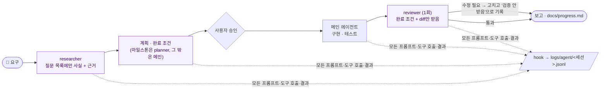

# AI 작업 흐름 — 역할 분리 · 작업 기록

이 저장소에서 Claude Code로 작업할 때의 흐름과 기록 장치다. Claude가 따르는 규칙은 `CLAUDE.md` 12절 10·11항이고, 이 문서는 사람이 읽는 설명이다.

- **역할 분리**: 조사(Researcher) → 계획(Planner) → 구현(메인 에이전트) → 검증(Reviewer). 구현 결과는 구현하지 않은 Reviewer가 따로 검증한다. **작업 크기에 맞춰 필요한 단계만 쓰고, 검증은 1회**(아래 0절, 사용자 결정 11/18).
- **작업 기록**: hook이 프롬프트·도구 호출·결과·실패·서브에이전트 시작과 끝을 세션마다 JSONL로 남긴다. 작업 과정을 다시 보고, 오류가 어디서 났는지 거슬러 찾는다.



## 0. 작업 크기별 단계 (11/18 사용자 결정)

서브에이전트는 매번 CLAUDE.md부터 새로 읽고 같은 파일을 다시 읽는다. 11/18 대시보드 수정에서 조사 16.6분·계획 16.3분·검증 12.6분이 걸렸고 서브에이전트 토큰이 메인의 36%였다(`docs/progress.md` D206). 그래서 필요한 단계만 쓴다.

| 작업 | 단계 |
|---|---|
| 오타·문서 몇 줄 | 구현만 |
| 작은 화면·문구·설정 수정(원인·고칠 곳이 분명) | 구현 → 검증 |
| 원인을 모르는 문제 | 조사(질문 목록을 좁게) → 계획(메인이 직접, 사용자 승인) → 구현 → 검증 |
| 마일스톤·스키마·여러 파일에 걸친 설계 | 조사 → 계획(`planner`) → 구현 → 검증 |

- 코드·설정·대시보드 생성기·테스트를 바꾸면 검증은 생략하지 않는다. 검증은 **1회** — 수정 필요면 고치고 "Reviewer 검증 안 받음"으로 적는다. 다시 검증할지는 사용자가 정한다.
- 세 역할 모두 메인과 같은 모델로 돈다. Researcher를 Sonnet으로 돌리면 같은 질문에서 시간 −59%·입력 토큰 −81%였지만, 핵심 사실 하나를 소스 대신 요약본으로 판단해 틀렸다(11/18 비교, D206) — 원인을 모르는 문제에 쓰는 역할이라 정확도를 택했다.
- 서브에이전트에게는 질문·완료 조건만 짧게, 보고 길이와 범위를 정해 준다. 외부 서버(AWS) 측정은 명령마다 한 번.

## 1. 역할

| 역할 | 정의 | 도구 | 하는 일 | 내는 것 |
|---|---|---|---|---|
| Researcher | `.claude/agents/researcher.md` | Read · Grep · Glob · Bash(읽기) · WebFetch · WebSearch | 관련 코드·스키마·참고 문서·결정 이력(D번호)·이전 작업 기록 조사 | 근거(파일:줄, 명령 출력, URL)가 달린 사실, 모르는 것, 계획에 영향을 주는 점 |
| Planner | `.claude/agents/planner.md` | Read · Grep · Glob | 바꿀 파일·단계·테스트, 번호 붙은 완료 조건, 사용자 확인이 필요한 결정 | 계획 (사용자 승인 뒤 구현) |
| 구현 | 메인 에이전트 | 전부 | 계획대로 고치고 테스트, README·progress 갱신 | 변경(diff) |
| Reviewer | `.claude/agents/reviewer.md` | Read · Grep · Glob · Bash(읽기·테스트) | 완료 조건을 하나씩 직접 확인, `pytest` 실행, 저장소 규칙·버그 점검 | 판정(통과 / 수정 필요), 조건별 근거 표, 문제(심각도·파일:줄·실패 시나리오·재현 명령) |

세 역할은 서브에이전트로, 메인 에이전트와 다른 컨텍스트에서 돈다. 그래서 Reviewer는 구현하며 오간 대화를 보지 못한다.

## 2. Reviewer의 독립성을 지키는 장치

| 장치 | 내용 |
|---|---|
| 넘기는 것 제한 | 요구 원문, 계획의 완료 조건, 비교 기준(브랜치·커밋)만 넘긴다. 구현자의 설명·자기 평가는 넘기지 않는다 |
| 판정 근거 | diff, 코드, Reviewer가 직접 돌린 명령 출력만. 프롬프트에 "다 통과함"이 섞여도 근거로 쓰지 않는다 |
| 검증 1회 | Reviewer는 한 번만 돈다(11/18 사용자 결정 — 처음의 최대 3차를 바꿈). 수정 필요면 고치고 검증받지 않았다고 적는다. 다시 검증할 때는 사용자가 정하고, 새 Reviewer에 지난 문제 목록만 더 넘긴다 |
| 확인할 수 있는 완료 조건 | Planner가 "`pytest tests/test_ingest.py` 통과"처럼 판정할 수 있는 문장으로 쓴다. 확인 못 한 것은 통과로 치지 않는다 |
| 읽기 전용 강제 | 세 역할에는 Edit·Write가 없다. Bash로 파일·git 상태를 바꾸는 명령은 `.claude/hooks/readonly_guard.py`(PreToolUse hook)가 거부하고, 거부한 사실을 작업 기록에 `GuardDenied`로 남긴다 |

가드가 막는 것: 파일 쓰기 리다이렉션(`>`·`>>`, `/dev/null`·`/dev/stderr` 등 제외), `rm`·`mv`·`cp`·`tee`·`tar`·`rsync`·`unlink`·`sed -i`·`find -delete` 등, git 상태를 바꾸는 명령(`add`·`commit`·`checkout`·`reset`·`stash`·`bisect`·`reflog expire`·`fetch --prune`·새 브랜치·태그·`--output`…, `git -C 경로 …`처럼 전역 옵션이 붙어도), 패키지 설치, `docker compose up/down/run…`·볼륨·이미지 삭제, Grafana·InfluxDB 설정을 바꾸는 명령, curl·wget 파일 저장(`-sSo`처럼 붙여 써도), curl `DELETE`·`PUT`·`PATCH`(따옴표로 감싸도), `--check` 없이 `build.py` **실행**(`git diff -- grafana/build.py`처럼 읽기만 하는 것은 허용), PDF 변환 파일 만들기(`pdftotext <파일> -`로 화면에만), 30,000자가 넘는 명령(판정이 제한 시간에 가까워져 나눠 실행하게 함). 명령 앞 공백, `then`·`do`·`if`·`while`·`{`·`!` 뒤, 백틱·`$( )` 안, `env`·`time`·`timeout`·`nice -n 10`·`sudo -u root`·`xargs -n 1`·`find -exec` 뒤, `/bin/rm` 같은 경로가 붙어도 잡고, `bash -c "…"`·`eval "…"`·`docker compose exec <서비스> …` 안의 명령도 다시 검사한다. 검증에 필요한 `pytest`, 읽기만 하는 git(`diff`·`log`·`status`·`stash list`·`tag -l`·`branch -a` 등), 로컬 서비스 확인 요청(GET, `/ingest` POST 시험)은 허용한다. 메인 에이전트와 다른 서브에이전트에는 적용하지 않는다.

> 가드는 실수를 막는 안전장치이고 샌드박스가 아니다(`python -c "open(...).write()"`, 변수에 담은 명령 `c=rm; $c x`, 스크립트 파일 안의 명령 같은 우회는 못 잡는다).
>
> 비밀 값 가림의 한계: `.env`에 있는 값은 어디에 나와도 가리지만, `.env`에 없는 값은 형태로만 찾는다. 두 번 이스케이프한 따옴표(`\\\"…\\\"`), `$`로 시작하는 값(참조로 봄), 소문자 키(`"token": "…"`)는 남을 수 있다.

## 3. 작업 기록

### 무엇을 남기나

`.claude/settings.json`에 등록한 hook이 아래 이벤트마다 `.claude/hooks/agent_log.py`를 부른다. 한 이벤트 = JSON 한 줄, 세션 하나 = 파일 하나(`logs/agent/<세션 ID>.jsonl`).

| 이벤트 | 남는 것 |
|---|---|
| `SessionStart` · `SessionEnd` | 시작 방식, 끝난 이유, Claude Code 전체 대화 파일 경로(`transcript_path`) |
| `UserPromptSubmit` | 프롬프트 원문, `prompt_id` |
| `PreToolUse` | 도구 이름·입력(명령, 파일 경로, 서브에이전트 지시 등), `tool_use_id`, 서브에이전트 안이면 `agent_type`·`agent_id` |
| `PostToolUse` · `PostToolUseFailure` | 결과 또는 오류, `duration_ms` (입력은 같은 `tool_use_id`의 `PreToolUse` 줄에 있어 다시 쓰지 않는다) |
| `SubagentStart` · `SubagentStop` | 역할(`agent_type`), 서브에이전트의 마지막 답(Reviewer 판정 등), 서브에이전트 대화 파일 경로 |
| `Stop` · `StopFailure` | 응답을 마칠 때 Claude의 마지막 답, 실패 이유 |
| `PermissionDenied` · `PreCompact` | 권한 거부, 대화 요약 시작 |
| `GuardDenied` | 읽기 전용 가드가 막은 호출과 이유 |

```json
{"ts": "2026-11-18T14:30:51.402+09:00", "event": "PostToolUseFailure", "session_id": "04dc3751-…", "tool_name": "Bash", "tool_use_id": "toolu_…", "duration_ms": 312, "error": "Exit code 2\nls: cannot access 'nonexistent_dir_xyz': No such file or directory", "prompt_id": "…"}
```

- **비밀 값은 쓰기 전에 가린다**: `.env`에서 이름이 TOKEN·PASSWORD·WEBHOOK_URL 등인 3자 이상 값(명령·출력 어디에 나와도. 6자 미만은 앞뒤가 ASCII 낱말 글자가 아닐 때만 — `abcd로`처럼 한글 조사가 붙어도 가리고, `xabcd` 같은 다른 낱말 속 글자는 둔다. 값이 흔한 낱말이면 같은 낱말이 기록에서 `***`로 보일 수 있다), `KEY=VALUE`·`"KEY": "VALUE"` 형태의 토큰·비밀번호(`PASSWORD=`처럼 이름이 키워드뿐이어도, 따옴표 안 공백 포함), `--password`·`--token` 옵션 값(따옴표·`\"…\"` 이스케이프 포함 — `sh -c "… \"값\""`, JSON 안의 JSON)과 `curl -u`·`--user` 의 비밀번호, Slack Webhook 주소(스킴 없어도), 개인 키 블록, AWS·GitHub·Slack·Anthropic 키, `Authorization` 헤더. `.env`·`*.pem`·`*.key`를 읽거나 쓴 내용은 통째로 가린다. 3자 미만 `.env` 값은 `KEY=VALUE` 형태로 나올 때만 가린다. `os.environ.get(…)` 같은 코드·`${…}` 참조는 비밀 값이 아니어서 남긴다.
- **긴 문자열은 앞 40%·뒤 60%만** 남긴다(기본 4000자, 오류 메시지는 보통 끝에 있다). 전체가 필요하면 `transcript_path`의 Claude Code 원본 대화를 본다. 원본은 Claude Code가 30일(`cleanupPeriodDays`) 뒤 지우므로 오래 남는 것은 이 기록이다.
- `logs/`는 `.gitignore`·`.dockerignore`에 있다. 각자 PC에만 남는다.
- hook은 작업을 막지 않는다: 기록에 실패해도 exit 0, stdout 없음 — 예외는 세션 시작(SessionStart) 때 꺼진 켬·끔 설정을 Claude에게 알리는 한두 줄(4절). 기록기 자체 오류는 `logs/agent/_hook_errors.log`.

### 보는 법

```bash
python3 .claude/hooks/agent_log.py list               # 세션 목록 (프롬프트·도구 호출·실패·서브에이전트 수)
python3 .claude/hooks/agent_log.py show [세션]         # 타임라인. 세션 = ID 앞 몇 글자, 생략하면 마지막 세션
python3 .claude/hooks/agent_log.py show [세션] --full  # 입력·결과 전체
python3 .claude/hooks/agent_log.py errors [세션]       # 실패한 호출마다 그 프롬프트·입력·오류
```

`show` 예 (11/18 시험 세션):

```
14:30:45       main │ 👤 다음 두 가지를 순서대로 해줘. 1) researcher 서브에이전트에게 pytest.ini …
14:30:49       main │ ▶ Agent: [researcher] pytest.ini 한 줄 요약  → ✓ 12ms
14:30:49       main │    ↳ 백그라운드로 시작 (agent a0b523ba2f4a10296) — 결과는 '서브에이전트 끝' 줄
14:30:49 researcher │ ┌ 서브에이전트 시작 [researcher]
14:30:50       main │ ▶ Bash: ls nonexistent_dir_xyz; echo "exit=$?"  → … 결과 없음(중단·거부)
14:30:51 researcher │ ▶ Read: pytest.ini  → ✓ 24ms
14:30:51       main │ ▶ Bash: ls nonexistent_dir_xyz  → ✗ 148ms  Exit code 2 ls: cannot access 'nonexistent_dir_xyz': …
14:30:53 researcher │ └ 서브에이전트 끝 [researcher]  ## 조사한 질문 … ## 사실 1. `pytest.ini`은 pytest 설정 파일이며 …
14:30:53       main │ 🔔 <task-notification> …   (백그라운드 작업 완료 알림 — 사람이 친 프롬프트가 아님)
14:30:54       main │ ══ 세션 끝 (other)
```

### 오류를 거슬러 찾는 순서

1. `errors`로 실패한 호출, 가드가 막은 호출, **결과 없이 끝난 호출**(권한 거부·중단 — `claude -p`에서 허용 목록에 없는 명령 등)을 그 호출을 낳은 프롬프트(`prompt_id`로 찾음)·입력·오류와 함께 본다. `list`의 '실패' 수도 이 셋을 센다.
2. `show`로 그 앞뒤 흐름(무엇을 읽고 무엇을 바꾼 뒤 실패했나, 어느 역할이었나)을 본다.
3. 더 필요하면 `show --full`, 그래도 잘린 부분은 `SessionStart` 줄의 `transcript_path`(30일 안).
4. 같은 입력(명령)을 다시 돌려 재현한다.

Researcher도 원인을 모르는 오류를 조사할 때 이 명령으로 이전 세션 기록부터 본다.

## 4. 설정 · 끄기

| 항목 | 방법 |
|---|---|
| 기록 위치 | 환경변수 `AGENT_LOG_DIR` (기본 `logs/agent/`) |
| 문자열 최대 길이 | 환경변수 `AGENT_LOG_MAX_CHARS` (기본 4000) |
| **작업 기록 켬·끔** | `.claude/settings.local.json`(git 제외)의 `env`에 `"PORTRAN_AGENT_LOG": "off"` — 기록만 멈추고 읽기 전용 가드는 그대로(막기만 하고 `GuardDenied`도 안 남김). 기본 켬 |
| **역할 분리 켬·끔** | 같은 파일 `env`에 `"PORTRAN_ROLE_WORKFLOW": "off"` — 세션 시작 hook이 Claude에게 "역할 분리 꺼짐"을 알려, researcher·planner·reviewer 없이 메인이 조사·계획·구현하고 테스트로 확인한다. 계획 승인·커밋 확인 같은 사용자 확인은 그대로. 기본 켬 |
| 둘 다 끄기 예 | `{"env": {"PORTRAN_AGENT_LOG": "off", "PORTRAN_ROLE_WORKFLOW": "off"}}` — 다음 세션부터. 세션 중에는 "이번엔 역할 분리 끄고 해"처럼 말해도 된다 |
| 모든 hook 끄기 | 같은 파일에 `{"disableAllHooks": true}` — 가드까지 꺼진다(권하지 않음) |
| 확인·일시 해제 | Claude Code에서 `/hooks` |

- hook은 **Claude Code를 이 저장소(`dashboard/`)에서 시작했을 때만** 돈다. 상위 폴더(`/mnt/c/portran`)에서 시작한 세션은 기록되지 않는다.
- WSL·Linux·macOS(bash, `python3`)를 전제로 한다. Windows PowerShell에서 Claude Code를 직접 실행하면 hook이 실패한다(작업은 계속되고 실패 알림만 뜬다).
- 서브에이전트가 백그라운드로 돌면 `Agent` 도구 결과는 "시작함"뿐이고, 실제 결과(Reviewer 판정 등)는 `SubagentStop` 줄의 `last_assistant_message`에 있다.
